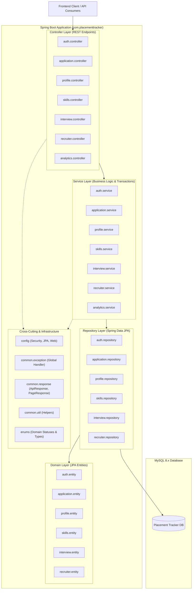

# System Architecture Documentation

## 1. Project Overview
The **Internship and Placement Application Tracker** is an enterprise-grade web application built to streamline campus placements and internship tracking for students, placement coordinators, and recruiters. The platform enables student profile management, skill comparison against job requirements, application lifecycle tracking, interview scheduling, recruiter communication logs, and placement readiness analytics.

---

## 2. Architectural Paradigm
The project is architected as a **Modular Layered Monolith** following **Domain-Driven Design (DDD)** concepts and **RESTful API** standards. Each functional domain is encapsulated within its own dedicated package, maintaining clean boundaries between business concerns while executing within a unified Spring Boot application runtime.

---

## 3. Layered Responsibilities

| Layer | Responsibility | Allowed Dependencies | Prohibited Practices |
|---|---|---|---|
| **Controller Layer** (`*.controller`) | Exposes HTTP REST endpoints, validates incoming DTOs (`@Valid`), coordinates with services, and returns unified `ApiResponse<T>` envelopes. | Service Layer, DTOs, Common Responses | Direct repository access, business logic execution, database entity exposure. |
| **Service Layer** (`*.service`) | Encapsulates core business rules, manages transaction boundaries (`@Transactional`), and maps between Entities and DTOs. | Repository Layer, Entity Layer, DTOs, Enums, Utils | Direct HTTP request/response handling, SQL statements. |
| **Repository Layer** (`*.repository`) | Spring Data JPA interfaces providing data access, pagination, sorting, and custom query specifications. | Entity Layer, Spring Data JPA | Business calculations, controller references. |
| **Entity Layer** (`*.entity`) | JPA entity classes representing relational database tables, relationships, and audit attributes. | JPA annotations, Enums, BaseAuditEntity | DTO references, service dependencies. |
| **DTO Layer** (`*.dto`) | Strong typed request and response contracts defining API payloads with Jakarta validation annotations. | Validation annotations, Enums | JPA annotations (`@Entity`, `@Table`), business logic. |
| **Configuration Layer** (`config`) | Declares Spring beans, Security filter chains, Web MVC CORS mappings, and JPA auditing. | Spring framework configuration components | Entity persistence, domain business logic. |
| **Exception Layer** (`common.exception`) | Global exception handler (`@RestControllerAdvice`), standard application exceptions, and error payload mappers. | Spring MVC, Common Response DTOs | Domain business transactions. |

---

## 4. Module Decomposition

### 4.1 Authentication Module (`com.placementtracker.auth`)
- **Owner**: Developer 1
- **Scope**: User account registration, role-based access control (Student, Recruiter, Placement Officer, Admin), password hashing, JWT token issuance, and authentication filters.

### 4.2 Application Module (`com.placementtracker.application`)
- **Owner**: Developer 1
- **Scope**: Job posting management, student internship/job application submission, deadline monitoring, status tracking (Applied, Shortlisted, In-Review, Rejected, Offered), and status history.

### 4.3 Student Profile Module (`com.placementtracker.profile`)
- **Owner**: Developer 2
- **Scope**: Student personal information, academic history, department, CGPA, graduation year, resume links, certifications, and portfolio links.

### 4.4 Skills Module (`com.placementtracker.skills`)
- **Owner**: Developer 2
- **Scope**: Skill taxonomy (technical, soft, domains), student skill endorsements, proficiency levels, and skill gap comparison against job posting requirements.

### 4.5 Interview Module (`com.placementtracker.interview`)
- **Owner**: Developer 3
- **Scope**: Multi-round interview tracking (Online Assessment, Technical Round 1/2, Managerial, HR), round scheduling, meeting links, recruiter feedback, and round outcomes.

### 4.6 Recruiter Module (`com.placementtracker.recruiter`)
- **Owner**: Developer 3
- **Scope**: Company directory, industry domains, recruiter point-of-contact details, hiring history, campus drive schedules, and relationship notes.

### 4.7 Analytics Module (`com.placementtracker.analytics`)
- **Owner**: Developer 3
- **Scope**: Placement readiness scoring, skill gap insights, application funnel conversion metrics, company hiring trends, and cohort-level placement reports. Note: Utilizes services and repositories from other modules; contains only `controller`, `service`, and `dto`.

---

## 5. Cross-Cutting Concerns
1. **Security**: Stateless JWT-based authentication, Spring Security filter chain, role-based method security (`@PreAuthorize`).
2. **Input Validation**: Jakarta Bean Validation (`@NotNull`, `@Size`, `@Email`, etc.) on all request DTOs.
3. **Unified API Contract**: All endpoints return standard `ApiResponse<T>` envelopes with HTTP status codes, timestamp, message, and typed data payload.
4. **Centralized Error Handling**: Uncaught exceptions handled via `@RestControllerAdvice` producing consistent `ErrorResponse` schemas.
5. **Database Auditing**: Common JPA audit attributes (`created_at`, `updated_at`, `created_by`, `updated_by`) for all entities.
