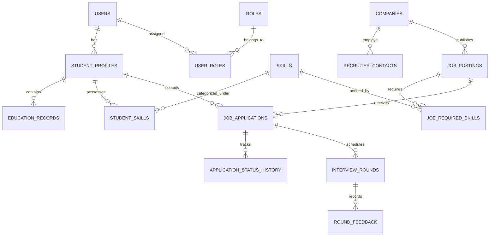

# Database Design and Schema Specification

## 1. Overview
The **Internship and Placement Application Tracker** uses **MySQL 8.x** as its relational database. The schema is organized into modular table groupings reflecting the application domains.

---

## 2. Conceptual Entity-Relationship Model



---

## 3. Planned Tables by Module

### 3.1 Authentication & Authorization (`auth`)
- `users`: Primary account credentials, email, password hash, status (`ACTIVE`, `PENDING`, `DISABLED`).
- `roles`: System roles (`ROLE_STUDENT`, `ROLE_RECRUITER`, `ROLE_ADMIN`, `ROLE_COORDINATOR`).
- `user_roles`: Many-to-many join table connecting users to roles.

### 3.2 Student Profile (`profile`)
- `student_profiles`: Bio, roll number, department, CGPA, graduation year, resume URL, phone number.
- `education_records`: 10th, 12th, undergraduate degree, institution name, percentages/grades, completion year.
- `social_links`: GitHub, LinkedIn, portfolio website links.

### 3.3 Skill Management (`skills`)
- `skills`: Master catalog of recognized skills (Java, Spring Boot, React, SQL, Problem Solving, etc.) with skill category.
- `student_skills`: Junction table associating students with skills, proficiency level (`BEGINNER`, `INTERMEDIATE`, `ADVANCED`), and verified flag.
- `job_required_skills`: Skills specified for a job posting, tagged as `MANDATORY` or `PREFERRED`.

### 3.4 Job & Application Management (`application`)
- `job_postings`: Company ID, role title, job description, package/stipend, location, eligibility criteria (minimum CGPA, allowed departments), application deadline.
- `job_applications`: Links student profile to job posting, submission timestamp, current application status.
- `application_status_history`: Audit trail of status transitions (`APPLIED`, `SHORTLISTED`, `INTERVIEW_SCHEDULED`, `REJECTED`, `OFFERED`), timestamp, and notes.

### 3.5 Interview Tracking (`interview`)
- `interview_rounds`: Application ID, round number, round type (`OA`, `TECHNICAL`, `MANAGERIAL`, `HR`), scheduled date/time, meeting link/venue, status (`SCHEDULED`, `COMPLETED`, `CANCELLED`).
- `round_feedback`: Interviewer remarks, rating (1-5), decision (`RECOMMENDED`, `NOT_RECOMMENDED`, `HOLD`).

### 3.6 Recruiter Directory (`recruiter`)
- `companies`: Company name, website, industry domain, headquarters, tier/category.
- `recruiter_contacts`: Name, email, phone number, designation, company ID, LinkedIn.
- `company_interactions`: Campus drive history, past hiring statistics, communication logs.

---

## 4. Database Conventions & Standards

### 4.1 Naming Conventions
- **Tables**: Lowercase plural in snake_case (e.g., `job_applications`, `student_profiles`).
- **Columns**: Lowercase singular in snake_case (e.g., `first_name`, `created_at`).
- **Primary Keys**: Named `id` of type `BIGINT AUTO_INCREMENT` or `VARCHAR(36)` (UUID).
- **Foreign Keys**: Named `<singular_referenced_table>_id` (e.g., `user_id`, `job_posting_id`).
- **Index Naming**:
  - Primary Key: `pk_<table_name>`
  - Foreign Key: `fk_<source_table>_<target_table>`
  - Unique Index: `uk_<table_name>_<column_name>`
  - Standard Index: `idx_<table_name>_<column_name>`

### 4.2 Standard Audit Fields
Every transactional entity must inherit standard auditing columns:
```sql
created_at    DATETIME(6) NOT NULL DEFAULT CURRENT_TIMESTAMP(6),
updated_at    DATETIME(6) NOT NULL DEFAULT CURRENT_TIMESTAMP(6) ON UPDATE CURRENT_TIMESTAMP(6),
created_by    VARCHAR(100),
updated_by    VARCHAR(100),
is_deleted    BOOLEAN NOT NULL DEFAULT FALSE
```

### 4.3 Soft Deletion Strategy
Critical business records (`users`, `job_applications`, `student_profiles`) should implement soft deletion via an `is_deleted` flag to preserve historical audit data for placement reports.

---

## 5. Migration Strategy
- In Phase 2, schema changes will be version-controlled using **Flyway** or **Liquibase** under `src/main/resources/db/migration/`.
- `spring.jpa.hibernate.ddl-auto` must remain set to `none` (or `validate` in production) to prevent unintended schema modifications.
